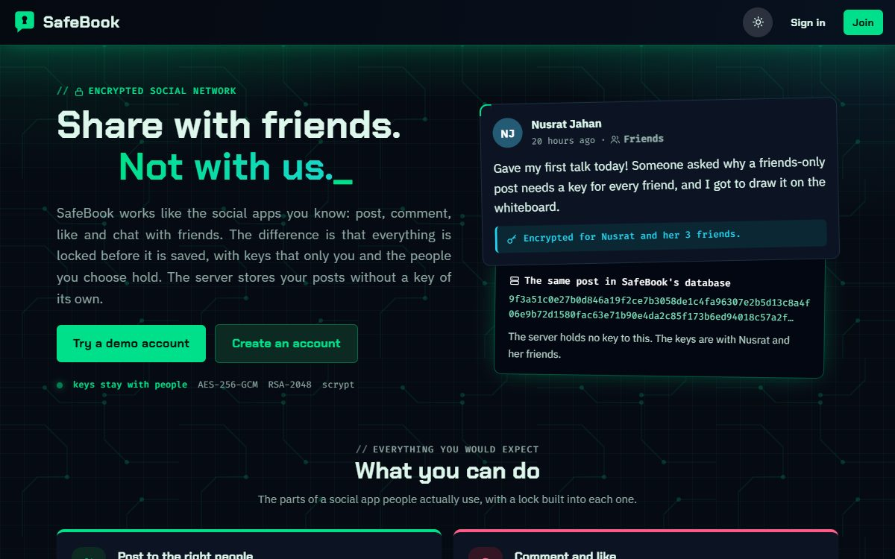
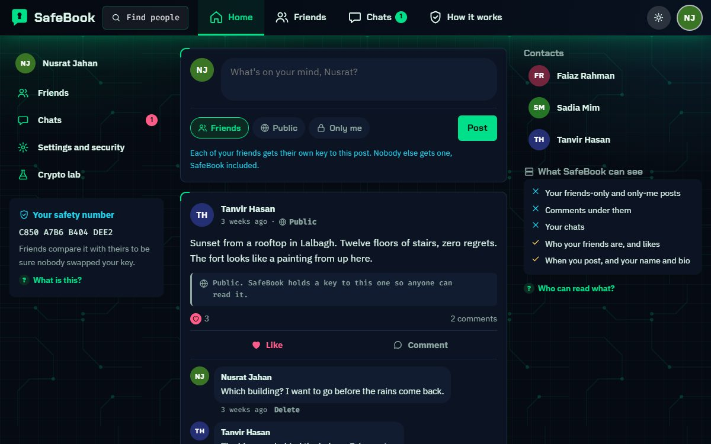

# SafeBook

[](https://github.com/FaiazPronoy/SafeBook/actions/workflows/tests.yml)

**A social network that keeps posts and chats encrypted, even in its own database.**
It works like the apps you know: friends, a news feed, posts, comments, likes
and chat. The difference is that posts and messages are stored encrypted, with
keys that only you and your friends can unlock.

| | |
|---|---|
| **Course** | CSE447: Cryptography and Cryptanalysis, BRAC University |
| **Type** | Group project |
| **Made by** | Faiaz Abrar Zaman Pronoy and Sinthia Khandoker |
| **Live demo** | https://fazpronoy.pythonanywhere.com |
| **Versions** | [v1.0, the first version, and v2.0, the rebuild](../../releases) |
| **History** | Built in Summer 2025 for the course. Rebuilt and published here in October 2026. |

| | |
|---|---|
|  |  |

---

## Features

**Social**
- Post to Friends, Public or Only me, and change it later
- Edit a post after it is up
- Comment and like
- Send, accept, decline and cancel friend requests, and unfriend
- Chat one to one with anyone
- Profiles, a news feed and a search for people

**Security you can see**
- A line under every post says who holds a key to it
- "Who holds a key" shows everyone who can open a post, and the stored encrypted text
- A safety number on each profile, to check a friend outside the app
- Your email and phone are stored encrypted
- Sign in history in your settings

**Safety**
- Two-step sign in, if you want it: after your password, a 6 digit code sent to your email
- Password eye and a strength meter on sign up
- Locks itself after 15 minutes of no activity
- A recovery code, shown once, to get back in if you forget your password
- Too many wrong passwords locks the account for a while

**Also**
- A cyber security look: dark by default, with a light mode
- Works on phones

---

## How the encryption works

- **Every post has its own key** (AES-256-GCM)
- **Friends:** a copy of that key is locked with each friend's RSA public key (RSA-OAEP)
- **Public posts:** a copy is locked with the server key, the only thing the server can open
- **Only me:** only your own copy exists
- **Your password** unlocks your data key through scrypt. The server never stores it.
- **Chats and comments** are encrypted too, and every record has a seal (HMAC) so tampering is caught
- Changing who can see a post adds or removes key copies. The post itself is never encrypted again.

So with the database, the `.env` file and the disk, an attacker still cannot
read a friends-only post or a chat.

---

## Built with

| Part | Tools |
|---|---|
| Backend | Python, Django 5 |
| Database | SQLite |
| Encryption | the `cryptography` library (AES-GCM, RSA-OAEP, scrypt, HMAC), argon2 |
| Frontend | Django templates, hand-written CSS and plain JavaScript |
| Static files | WhiteNoise |
| Tests | Django's test runner, Playwright |

Fonts: Chakra Petch, IBM Plex Sans and Fira Code.

---

## Demo logins

The front page shows the demo people as cards. Pick one to sign in as them.

| Person | Username | Password |
|---|---|---|
| Nusrat Jahan | `nusrat` | `Nusrat#2026safe` |
| Faiaz Rahman | `faiaz` | `Faiaz#2026safe` |
| Tanvir Hasan | `tanvir` | `Tanvir#2026safe` |
| Sadia Mim | `mim` | `Mim#2026safe` |

Two-step sign in stays off on the demo accounts, so they always open. Make your own
account to try it.

Try this: sign in as Mim and open Faiaz's profile (his friends-only posts are
hidden). Then sign in as Faiaz, accept Mim's request, and sign in as Mim again.

---

## Run it

You need **Python 3.10+**.

- **Windows:** double-click `RUN-SafeBook.bat`. It installs the packages, makes fresh keys, prepares the database and opens <http://127.0.0.1:8010>.
- **By hand:**

```bash
python -m venv .venv
.venv\Scripts\activate
pip install -r requirements.txt
copy .env.example .env
python manage.py new_keys --write
python manage.py migrate
python manage.py seed_demo
python manage.py runserver
```

---

## Settings

Copy `.env.example` to `.env`. `python manage.py new_keys --write` fills in both keys for you. The `.env` file is never committed.

| Variable | What it is |
|---|---|
| `SECRET_KEY` | Django's secret key |
| `APP_KEK_BASE64` | The server key that locks public posts (32 random bytes, base64) |
| `KEYMGMT_ACTIVE_KEK_ID` | Which server key is in use (`manage.py rotate_kek` updates it) |
| `DEBUG` | `True` for local work only |
| `ALLOWED_HOSTS` | Host names the site answers to |
| `EMAIL_HOST_USER`, `EMAIL_HOST_PASSWORD` | Optional. The Gmail address and app password that send two-step codes. Left empty, codes are printed in the terminal. |

---

## Tests

- `python manage.py test` runs **136 tests**
- They prove that the database and the server key alone cannot open friends-only posts, that keys move correctly when friends change, and that tampering is caught
- Two-step sign in is tested end to end: wrong, reused and expired codes are refused
- `tools/browser_checks.py` opens every page and checks contrast in both themes and on a phone

---

## Folder layout

```
secureapp/
  crypto.py, keys.py, keyring.py   encryption and key handling
  social.py, friends.py, chat.py   posts, friends and chat
  templates/, static/              pages, CSS and JavaScript
  tests/                           the test suites
safebook/                          Django settings
keymgmt/                           the server key for public posts
tools/                             browser checks
```

---

## Notes

- This is not end-to-end encryption. While you are signed in, the server uses your key to show you your posts, and it can read a public post on purpose. What it protects against is a stolen database, disk or `.env` file.
- This is a learning project. Its design has not been reviewed by an independent security auditor, so it should not be used where real security is needed.
- Forgetting your password and losing the recovery code means the posts cannot be opened again. That is the cost of the server not holding your keys.

---

## Who built it

Faiaz led the project and designed the encryption. He split the social side of
the app with Sinthia and reviewed her work before it was merged.

- **Faiaz Abrar Zaman Pronoy** (ফাইয়াজ আবরার জামান প্রনয়), lead developer
  - The key design: a key per post, RSA copies for friends, scrypt for passwords
  - The encryption code in `crypto.py`, `keys.py` and `keyring.py`, and the HMAC seals
  - Posts and audiences, the recovery code and server key rotation
  - The test suite that tries to read and tamper with the stored data
- **Sinthia Khandoker** (সিনথিয়া খন্দকার)
  - Friends and friend requests
  - The chat and the profile pages
  - Sign up, with the password strength meter

## Licence

Copyright 2026 Faiaz Abrar Zaman Pronoy and Sinthia Khandoker. All rights reserved.
You may read the code and run it to try it out. You may not copy it, hand it in
as your own work, or publish it. See [LICENSE](LICENSE).
